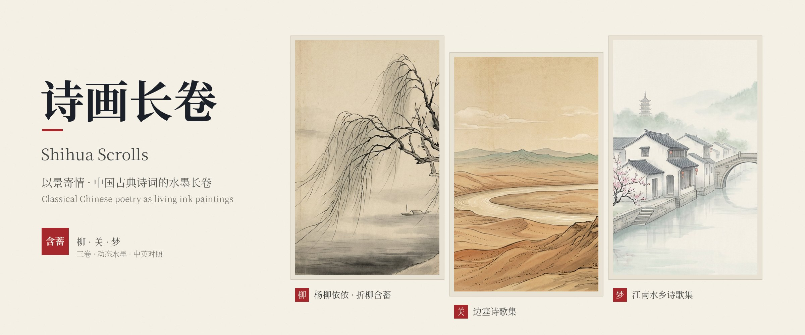
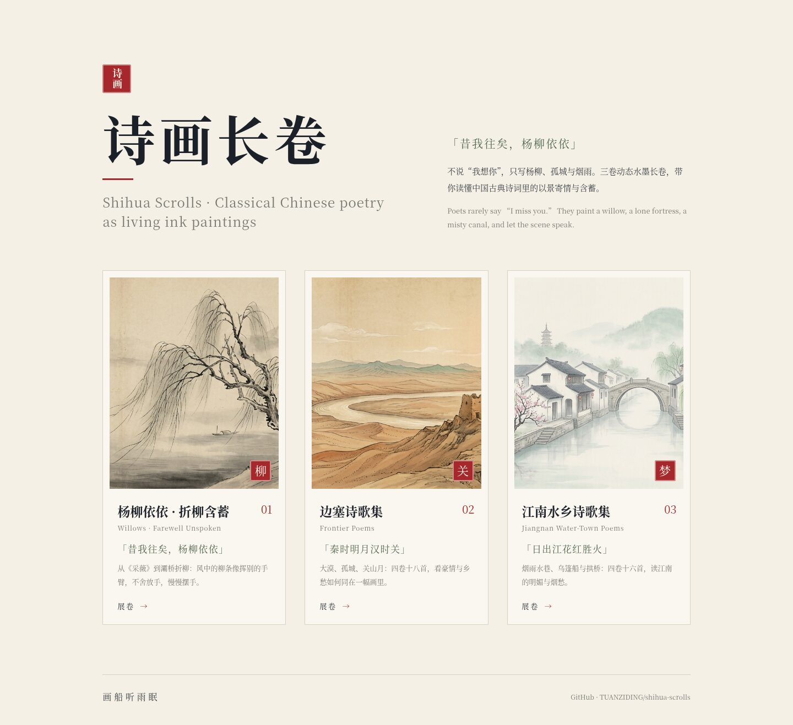
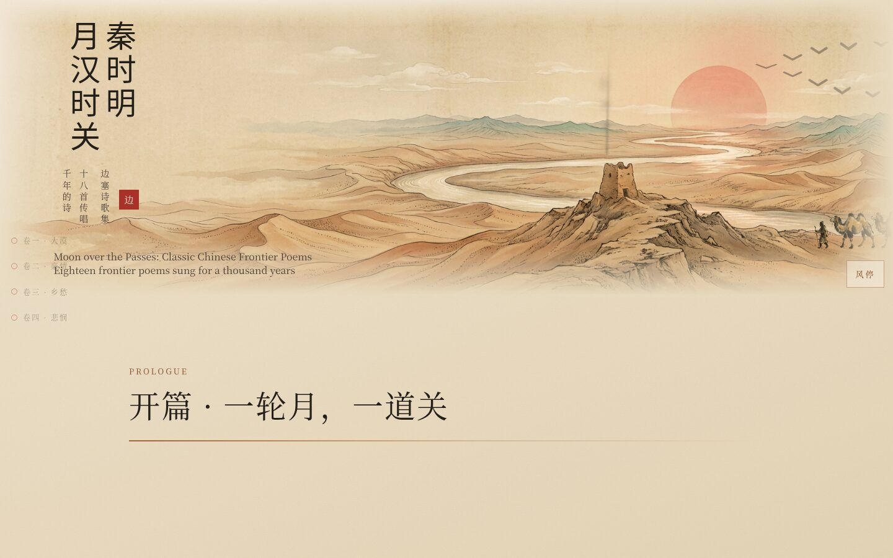
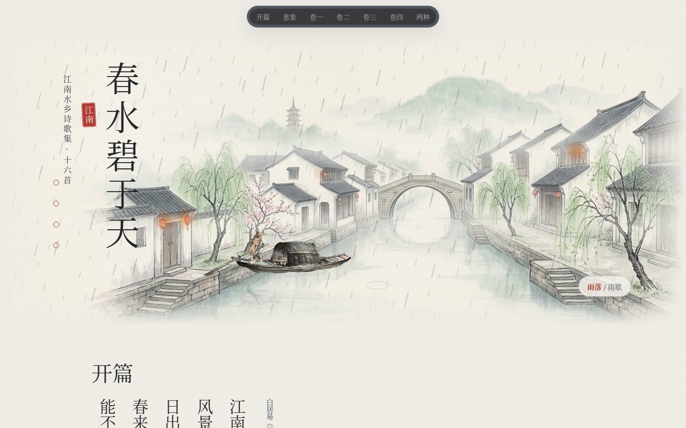
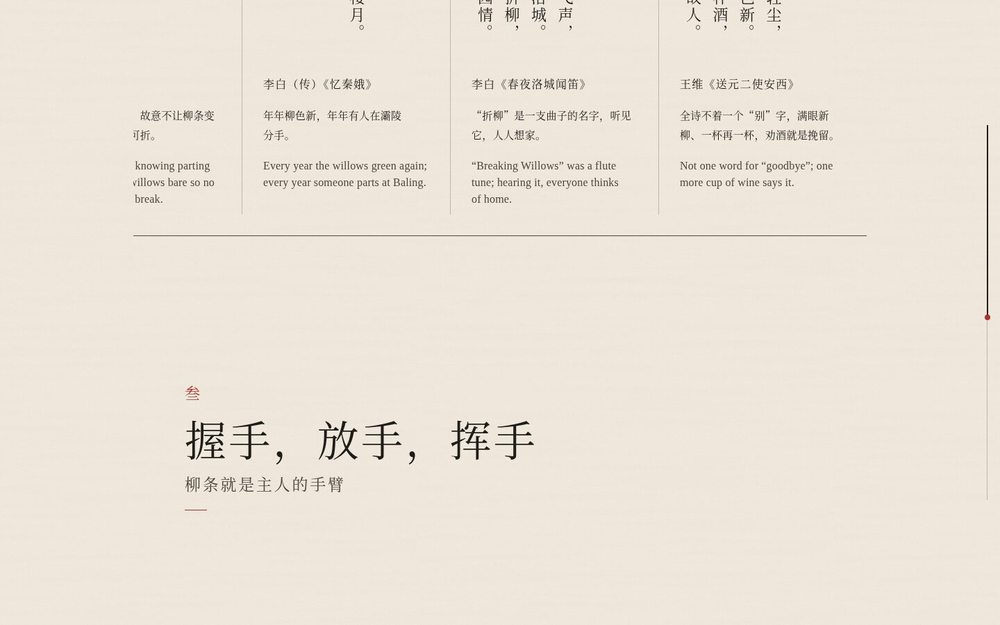
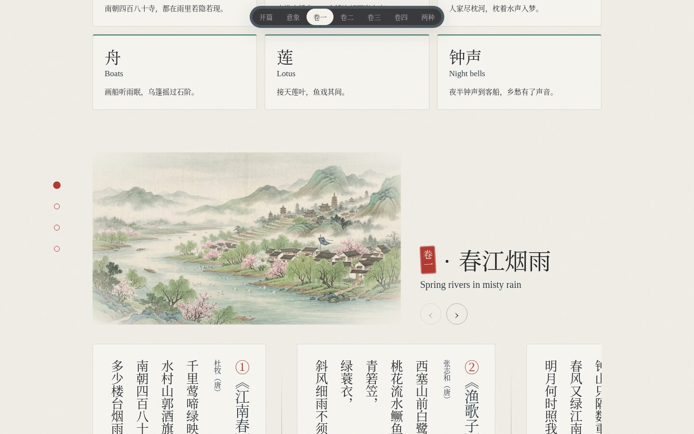
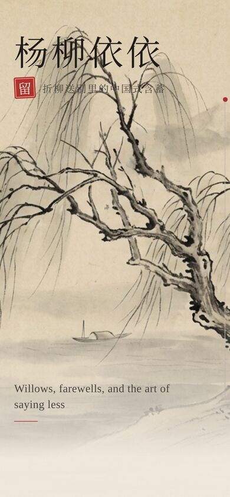
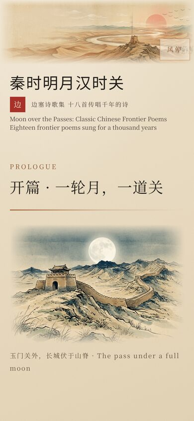
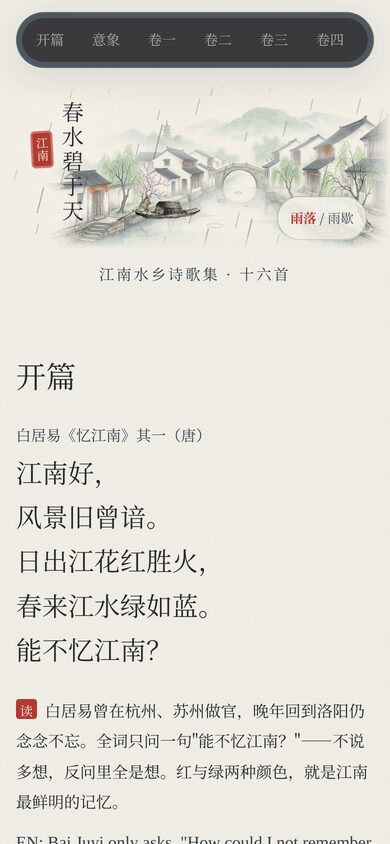

<p align="center">
  
</p>

<h1 align="center">诗画长卷 · Shihua Scrolls</h1>

<p align="center">
  <strong>不说“我想你”，只写杨柳、孤城与烟雨：三卷动态水墨长卷，读懂中国诗词的以景寄情</strong><br>
  Classical Chinese poetry as living ink-painting scrolls, where the scenery speaks for the heart
</p>

<p align="center">
  给中文学习者、语文课堂、对外文化交流和喜欢古诗词的人的纯静态网页：诗句逐字浮现、画卷缓缓流动，中文为主，附英文对照。<br>
  A static, bilingual site for learners, classrooms and anyone curious about the restraint of Chinese poetry.
</p>

<h3 align="center">
  <a href="https://tuanziding.github.io/shihua/">▶ 一键在线展卷 · Open the scrolls</a>
</h3>

<p align="center">
  <a href="README.md">简体中文</a> · <a href="文档/英文说明v1.0.md">English</a>
</p>

<p align="center">
  <code>三卷 · 柳 / 关 / 梦</code> · <code>动态水墨长卷</code> · <code>诗句逐字浮现</code> · <code>中英对照</code> · <code>纯静态 · 无需构建</code> · <code>手机友好</code>
</p>

<p align="center">
  <a href="#use-cases">使用场景</a> ｜ <a href="#showcase">实际界面</a> ｜ <a href="#quick-start">快速开始</a> ｜ <a href="#contents">三卷内容</a> ｜ <a href="#capabilities">能力状态</a> ｜ <a href="#license">版权与许可</a>
</p>

<p align="center"><sub>封面由本仓库三幅 AI 生成水墨画拼排而成，不是真实截图。</sub></p>

> 🖌️ 核心解读：告别时我们会握手、再摆手。水边迎风的柳条，就像主人的手臂——不舍地放手，又慢慢地挥别。“柳”谐“留”，折柳赠别，把说不出口的话交给风景。这是中国式的含蓄，与直抒胸臆是两种同样动人的表达传统。

---

<a id="use-cases"></a>

## 用在哪里 · Use cases

| 你想做什么 | 可以怎样开始 |
| --- | --- |
| 给外国朋友讲“中国人为什么不直说” | 打开 [杨柳依依](https://tuanziding.github.io/shihua/yangliu-yiyi/)，从《采薇》看到“握手 → 放手 → 挥手”与柳条的对照 |
| 语文课导入一组主题诗 | [边塞诗歌集](https://tuanziding.github.io/shihua/biansai/) 按大漠风光、壮志豪情、征人乡愁、战争悲悯四卷排列；投影即可上课 |
| 带孩子读江南诗、认意象 | [江南水乡诗歌集](https://tuanziding.github.io/shihua/jiangnan/) 先认烟雨、小桥、流水、舟、莲、钟声六个意象，再读诗 |
| 体会“含蓄”与“直抒”的差别 | 每卷末尾都有一组对照：同一种情感，两种说法 |
| 做自己的诗词主题页 | 复制任一子目录，替换诗文与画作；结构固定为“动态主图 → 开篇诗 → 意象 → 分卷诗条 → 两种表达 → 尾句印章” |

<a id="showcase"></a>

## 实际界面 · Showcase

[](https://tuanziding.github.io/shihua/)

<sub>总目录（桌面 1440 px）：三卷各配一枚印章——柳、关、梦。</sub>

| 杨柳依依 · 折柳含蓄 | 边塞诗歌集 | 江南水乡诗歌集 |
| --- | --- | --- |
| [](https://tuanziding.github.io/shihua/yangliu-yiyi/) | [](https://tuanziding.github.io/shihua/biansai/) | [](https://tuanziding.github.io/shihua/jiangnan/) |
| [](https://tuanziding.github.io/shihua/yangliu-yiyi/) | [](https://tuanziding.github.io/shihua/biansai/) | [](https://tuanziding.github.io/shihua/jiangnan/) |
| [在线展卷 →](https://tuanziding.github.io/shihua/yangliu-yiyi/) | [在线展卷 →](https://tuanziding.github.io/shihua/biansai/) | [在线展卷 →](https://tuanziding.github.io/shihua/jiangnan/) |

| 手机 · 杨柳依依 | 手机 · 边塞 | 手机 · 江南 |
| --- | --- | --- |
| [](https://tuanziding.github.io/shihua/yangliu-yiyi/) | [](https://tuanziding.github.io/shihua/biansai/) | [](https://tuanziding.github.io/shihua/jiangnan/) |

<sub>真实截图（Chromium 渲染；桌面 1440 px，手机 390 px）。动态效果请在线查看。</sub>

<a id="quick-start"></a>

## 先用起来 · Quick start

1. 手机或电脑浏览器打开 **[在线版](https://tuanziding.github.io/shihua/)**；iPhone 可点“分享 → 添加到主屏幕”。
2. 上课投影：直接全屏打开某一卷，向下滚动即逐段展开。
3. 离线使用：下载整个仓库（Code → Download ZIP），双击根目录 `index.html`。

```sh
git clone https://github.com/TUANZIDING/shihua-scrolls.git
cd shihua-scrolls && python3 -m http.server 8000   # 打开 http://localhost:8000
```

<a id="contents"></a>

## 三卷内容 · Contents

| 卷 | 目录 | 开篇 | 结构 |
| --- | --- | --- | --- |
| 柳 · 杨柳依依 · 折柳含蓄 | `yangliu-yiyi/` | 《诗经·小雅·采薇》 | 一首诗的开头 → 柳，就是“留” → 握手，放手，挥手（柳堤送别·孤舟远去动态场景）→ 两种告别的语言 |
| 关 · 边塞诗歌集 | `biansai/` | 王昌龄《出塞》 | 五个意象 → 四卷十八首：大漠风光 · 壮志豪情 · 征人乡愁 · 战争悲悯 → 两种声音 |
| 梦 · 江南水乡诗歌集 | `jiangnan/` | 白居易《忆江南》 | 六个意象 → 四卷十六首：春江烟雨 · 水巷舟桥 · 西湖莲塘 · 烟雨闲愁 → 两种江南 |

```text
shihua-scrolls/
├── index.html          总目录
├── yangliu-yiyi/       杨柳依依（页面 + 画作 + 样式脚本）
├── biansai/            边塞诗歌集
├── jiangnan/           江南水乡诗歌集
└── 文档/
    ├── 主图/           封面
    ├── 截图/           真实界面截图
    └── 英文说明v1.0.md
```

<a id="capabilities"></a>

## 当前做到哪一步 · Capability status

| 状态 | 内容 | 实际边界 |
| --- | --- | --- |
| 已完成 | 三卷页面、动态主图、诗句逐字浮现、中英对照 | 英文为意译导读，不是逐字翻译 |
| 已核对 | 诗文与作者、出处 | 据《诗经》《全唐诗》《全宋词》《乐府诗集》等通行本；个别字有异文 |
| 已检查 | 375 / 768 / 1280 / 1440 px 显示 | 尊重系统“减少动态效果”设置 |
| 计划中 | 更多主题卷（如月、雁、梅）、朗读音频 | — |

<a id="license"></a>

## 版权与许可 · License

- 古诗文原文属公有领域。
- 画作为 AI 生成的意象画，与页面代码、导读文字一起，以 [CC BY-NC 4.0](https://creativecommons.org/licenses/by-nc/4.0/) 供非商业学习与教学使用，请注明出处。

<p align="center"><sub>画船听雨眠 · 丁海祥 Haixiang Ding · <a href="https://tuanziding.github.io/#culture">个人主页</a></sub></p>
